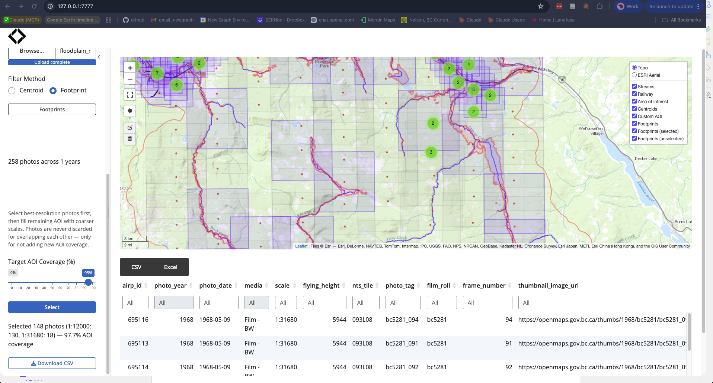

# diggs 

**Delineation-Informed Geographic Ground Selection** — an interactive Shiny app for selecting historic orthophoto imagery from the [BC Data Catalogue](https://catalogue.data.gov.bc.ca/dataset/airphoto-centroids).

Historic airphotos are ground truth for understanding what floodplains looked like before roads, railways, agriculture, and forestry reshaped them. Was that rangeland always rangeland — or was it an old growth cottonwood forest-wetland complex? diggs helps you find the photos to answer that question.

Filter by year, media type, and scale. Draw or upload an AOI. View estimated photo footprints. Run resolution-prioritized selection to get the best coverage with the fewest photos. Export to CSV and order from the [BC Air Photo Warehouse](https://www2.gov.bc.ca/gov/content/data/geographic-data-services/air-photos).

<br>

<p align="center">
  
</p>

## Install

```r
# install.packages("pak")
pak::pak("NewGraphEnvironment/diggs")
```

## Quick Start

```r
# 1. Cache data layers for your watershed (one-time, ~5 min)
#    Edit data-raw/cache_data.R to set blk/drm for your watershed
source(system.file("data-raw/cache_data.R", package = "diggs"))

# 2. Launch
diggs::run_app()
```

### Configure Your Watershed

Open `data-raw/cache_data.R` and change three parameters:

```r
blk <- 360873822    # blue_line_key — unique stream ID
drm <- 166030.4     # downstream_route_measure — how far upstream (metres)
buf <- 1500         # buffer around watershed (metres)
```

Find `blk` and `drm` for your stream on the [FWA Stream Network map](https://features.hillcrestgeo.ca/fwa/index.html) — click a stream and read the popup.

### Custom AOI

Within the configured watershed, switch to **Custom** mode to refine your area of interest:

- **Draw** a polygon directly on the map
- **Upload** a GeoJSON or GeoPackage (e.g. a floodplain polygon from QGIS)

The custom AOI must fall inside the watershed configured at startup — photo centroids are only cached for that region. To work in a different watershed, update `blk`/`drm` in `cache_data.R` and re-run.

## How It Works

1. **Filter** — narrow by year range, media type (B&W, colour, infrared), and scale
2. **Explore** — clustered centroids on the map with popups showing photo metadata
3. **Footprints** — estimate photo coverage rectangles from scale and focal length
4. **Select** — resolution-prioritized greedy set-cover: picks all photos at the finest scale first, then backfills remaining AOI gaps with coarser scales
5. **Export** — download selection as CSV for ordering

Selection uses [fly](https://github.com/NewGraphEnvironment/fly) under the hood for spatial photo operations (footprint estimation, filtering, coverage-based selection).

## Part of the Ecosystem

diggs is one piece of a larger floodplain analysis workflow:

<!-- BEGIN ecosystem.yml -->
<!-- Generated from the source registry; edit the registry, not this block. -->

| Package | Role |
|---|---|
| [link](https://www.newgraphenvironment.com/link/) | Build, compare and test fish habitat and access models, every fish habitat definition editable |
| [fresh](https://www.newgraphenvironment.com/fresh/) | Splits streams at barriers, classifies habitat by species, traces what's upstream |
| [wet](https://www.newgraphenvironment.com/wet/) | Typical flow in nearly every stream, tested against gauges; station flow and temperature |
| [flooded](https://www.newgraphenvironment.com/flooded/) | Maps floodplains from terrain: the valley floor a river can spread across |
| [drift](https://www.newgraphenvironment.com/drift/) | Maps what changed in land cover, where and when, in a floodplain or any area, from free satellite maps or your own |
| [fly](https://www.newgraphenvironment.com/fly/) | Puts BC's historic airphotos back on the map from free thumbnails |
| [cd](https://www.newgraphenvironment.com/cd/) | How far any BC watershed's climate has shifted from your chosen baseline |
| [knowledge](https://www.newgraphenvironment.com/knowledge/) | Starts from each species' life history and tunes its fish habitat definitions from where sampling did and did not catch it |
| [floodplains](https://www.newgraphenvironment.com/floodplains/) | Maps BC's floodplains and how the land in them changed, one watershed group at a time |
| [crate](https://www.newgraphenvironment.com/crate/) | Canonical schemas for data that changes shape, and provenance receipts for outputs |
| [stac_floodplains_bc](https://www.newgraphenvironment.com/stac_floodplains_bc/) | Floodplains and land-cover change, a screen for where to look; by watershed group |
<!-- END ecosystem.yml -->

Its sibling app, [breaks](https://www.newgraphenvironment.com/breaks/), clicks a stream, snaps to it, and delineates the watershed above the break.

Together: query the stream network (fresh), delineate the floodplain (flooded), find what it looked like historically (diggs + ordered airphotos), and measure what changed since (drift). The combination answers questions like: *where were the wetlands before this became pasture? Where did cottonwood galleries disappear? What was the riparian condition when salmon populations were healthy?*
